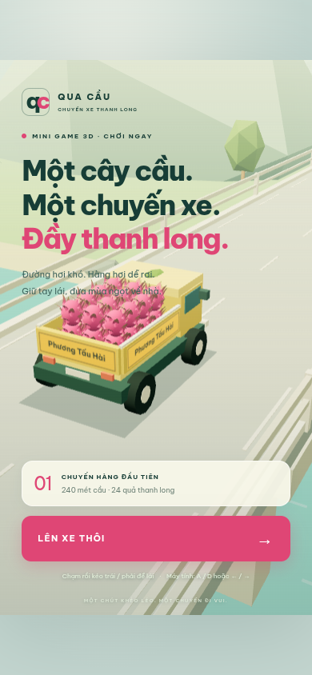

# Qua cầu · Chuyến xe thanh long

Mini game 3D chạy trên web, ưu tiên màn hình dọc 9:16. Lái xe chở 24 quả thanh long qua cây cầu dài 240 mét, tránh đá, thùng hàng, rào chắn và gà/chó đi qua lại. Va chạm làm xe chao đảo và hất trái cây khỏi thùng. Điểm là số quả còn lại khi về đích. Mất hết hàng thì kết thúc chuyến đi.



## Chơi

- Điện thoại: chạm bất kỳ chỗ trống nào trên màn hình rồi **kéo trái / phải** để lái. Nhấc tay, chạm lại để tiếp tục. Xe tự chạy và tăng tốc dần; không có nút đi chậm.
- Máy tính: kéo chuột, hoặc **A / D** và **← / →** để lái.
- **P / Esc** để tạm dừng. Chuyển tab hoặc mất focus cũng tự tạm dừng.
- Không có nhạc nền hoặc nút âm thanh. Chỉ giữ tiếng va chạm, rơi quả, gà/chó và hiệu ứng về đích; dùng âm lượng thiết bị để điều chỉnh.
- Kỷ lục được lưu trên trình duyệt; không cần tài khoản.

## Phát triển

Node.js **22.12+** hoặc **24+**, npm. Trong checkout hiện tại:

```sh
npm ci --cache /workspace/.npm-cache
npm run dev -- --port 5173
```

Trên máy cá nhân có thể bỏ `--cache /workspace/.npm-cache`. Mỗi cloud task đã có môi trường cô lập, sử dụng checkout sẵn có; không cần tạo Git worktree.

```sh
npm run build
npm run preview -- --port 4173
```

`npm run build` kiểm tra TypeScript và tạo website tĩnh trong `dist/`. Đường dẫn tài nguyên tương đối nên hỗ trợ cả domain riêng lẫn GitHub Pages tại `/gamequacau/`. Không cần backend, khóa API hoặc CDN. Font, thư viện và mô hình đều được đóng gói / tạo tại chỗ.

## Kiểm tra trình duyệt

Chạy dev server ở cổng 5173 trước. Cài browser của Playwright trên máy cá nhân:

```sh
npx playwright install chromium
npm run test:smoke
```

Trong môi trường cloud hiện tại dùng Chromium có sẵn:

```sh
CHROMIUM_PATH=/usr/bin/chromium npm run test:smoke
```

Bộ smoke test kiểm tra 9:16 trên điện thoại và desktop, giữ đủ 24 quả khi chạy thẳng nhẹ nhàng, va chạm làm rơi hàng, phím lái, kéo cảm ứng hai hướng, nhấc tay/chạm lại/hủy thao tác, tạm dừng / tiếp tục, reset, chuyển động của gà/chó và chạy tới cuối cầu còn hàng. Kiểm tra không có âm thanh nền liên tục, tốc độ tăng dần, camera bám cùng thời điểm với xe và giới hạn số lượt vẽ. Diagnostics chỉ tồn tại trong dev build. Ảnh kiểm tra được lưu ở `/tmp/gamequacau-*.png`. Có thể đổi URL bằng `GAME_URL` (phải dùng dev server để có diagnostics).

Kiểm tra riêng chuyển động với màn hình 120 Hz và nhịp render không đều:

```sh
CHROMIUM_PATH=/usr/bin/chromium npm run test:smoothness
```

Bài kiểm tra điều khiển timestamp của requestAnimationFrame và xác minh xe tiếp tục di chuyển giữa các bước vật lý, không nhảy ngược, camera không trễ hoặc nhấp nhô. Đây là kiểm tra thời điểm render, không phải benchmark FPS trên điện thoại thực tế.

## Bản web công khai

Website dùng bản build trên nhánh **gh-pages**. Trong GitHub repository, vào **Settings → Pages → Build and deployment**, chọn **Deploy from a branch**, nhánh **gh-pages**, thư mục **/(root)**, rồi **Save**. Nếu repository private và gói GitHub không hỗ trợ Pages, hãy dùng dịch vụ static hosting hỗ trợ repository private hoặc tự quyết định đổi visibility.

Sau khi GitHub deploy thành công, chơi tại **https://nvluu.github.io/gamequacau/**. Địa chỉ này chỉ hoạt động sau khi Pages được bật và deployment hoàn tất.

Để đưa bản build mới lên hosting khác, chạy `npm run build` và upload toàn bộ thư mục `dist/`. Không mở trực tiếp `index.html` bằng `file://`; game cần được phục vụ qua HTTP(S).

Sau khi commit thay đổi mã nguồn, cập nhật GitHub Pages bằng `npm run deploy:pages`. Lệnh build, cập nhật nhánh triển khai qua checkout tạm và push bình thường (không force). Lệnh kiểm tra nhánh triển khai chỉ có các file build đã biết trước khi thay thế chúng. Cần quyền Git push; không cần quyền API Pages.

## Công nghệ và giới hạn

TypeScript, Vite, Three.js, Rapier. Bản 0.3 gộp hình tĩnh và xe theo vật liệu, vẽ 24 quả thanh long bằng instancing, thay bóng động bằng bóng đơn giản, giới hạn pixel ratio 1 và tự hạ xuống 0.85 khi máy chậm. Chuyển động được nội suy giữa các bước vật lý 60 Hz; camera, xe, trái cây và động vật dùng chung thời điểm vẽ. Camera không còn trễ theo chiều tiến và xe không rung khi chạy bình thường. Biển đích dùng texture chữ lớn, vật liệu không bị ảnh hưởng bởi sương/ánh sáng; thùng xe mang chữ “Phương Tấu Hài”. Suối có vệt nước chảy ngang bên dưới cầu. Tạo hình low-poly bằng code, không cần tải asset từ dịch vụ ngoài. Thanh long dùng rigid bodies thật; thùng xe có lực giữ nhẹ mô phỏng độ bám khi chạy bình thường, giảm lực giữ trong va chạm để hàng rơi ra. Xe dùng điều khiển arcade, va chạm vật cản được phát hiện ở lớp gameplay; chưa mô phỏng đầy đủ bánh xe / hệ thống treo. Lan can giữ xe trên cầu, bản này chưa có xe rơi khỏi cầu. Một màn chơi cố định, chưa có nhiều level hoặc bảng điểm online.

Yêu cầu trình duyệt có WebGL2 / tăng tốc phần cứng. Đã kiểm tra Chromium mô phỏng viewport điện thoại; vẫn cần thử cảm giác lái và hiệu năng trên điện thoại thực tế, đặc biệt Safari iOS.
